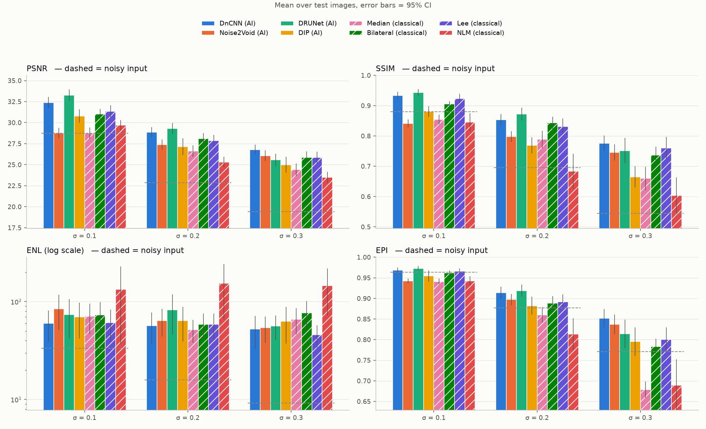
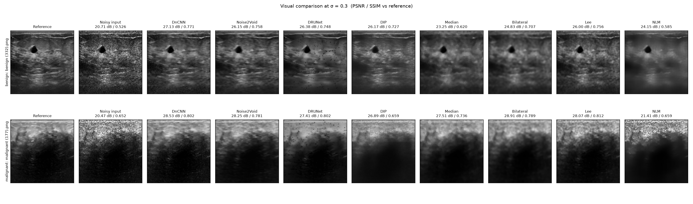

# SpeckleBench-BUSI

**AI vs classical speckle reduction on breast ultrasound — a reproducible benchmark.**

Four deep-learning denoisers, each in a different training regime, are compared with four classical
filters on the [BUSI](https://www.kaggle.com/datasets/aryashah2k/breast-ultrasound-images-dataset)
breast-ultrasound dataset. Every method gets the same images, the same pre-generated noise, the same
validation-only tuning, and is scored with PSNR, SSIM, ENL, EPI, processing time and paired
statistical tests.

| Repository content | |
|---|---|
| [`busi_speckle_benchmark.py`](busi_speckle_benchmark.py) | The whole experiment in one script: data, noise, 8 methods, metrics, statistics, figures, report |
| [`run_in_colab.ipynb`](run_in_colab.ipynb) | Colab notebook: installs dependencies, runs a smoke test, then the full experiment |
| [`results/`](results/) | Outputs of the reported run (CSV tables, statistics, figures, `report.md`, `run.log`) |
| [`results_quick/`](results_quick/) | Outputs of the `--quick` smoke test (pipeline check only, numbers not meaningful) |
| [`FINAL_ANALYSIS.md`](FINAL_ANALYSIS.md) | Written analysis of the results |
| [`BUSI_Speckle_Reduction_Report.docx`](BUSI_Speckle_Reduction_Report.docx) | Full project report |

---

## Headline results

Reported run: `--cpu_preset` on a laptop CPU (Intel i5-10210U, no GPU) — 128×128 images,
15 test / 10 val / 200 train, all eight methods on the same CPU. Mean over σ ∈ {0.1, 0.2, 0.3}:

| Method | Type | PSNR (dB) | SSIM | EPI | ENL | Time / image | Mean rank ↓ |
|---|---|---|---|---|---|---|---|
| **DnCNN** | AI, supervised | 29.35 | 0.854 | **0.912** | 56.4 | 191 ms | **1.82** |
| DRUNet | AI, pretrained zero-shot | **29.37** | **0.856** | 0.902 | 70.9 | 637 ms | 1.96 |
| **Lee** | classical | 28.34 | 0.838 | 0.886 | 55.0 | 0.7 ms | 3.62 |
| Bilateral | classical | 28.33 | 0.828 | 0.878 | 69.5 | **0.6 ms** | 4.04 |
| Noise2Void | AI, self-supervised | 27.40 | 0.795 | 0.892 | 67.5 | 64 ms | 4.97 |
| Deep Image Prior | AI, untrained | 27.63 | 0.771 | 0.877 | 65.5 | 103.9 s | 5.53 |
| Median | classical | 26.59 | 0.768 | 0.827 | 62.6 | 13.8 ms | 6.90 |
| NLM | classical | 26.17 | 0.711 | 0.815 | 144.0 | 44 ms | 7.16 |

- **Best AI model: DnCNN.** About +1 dB PSNR over Lee at every noise level, on 15/15 images
  (Holm-adjusted p = 0.003), and the best edge preservation at high noise.
  DRUNet is best at σ = 0.1–0.2 with no training at all, but degrades at σ = 0.3.
- **Best classical filter: Lee** — within ~1 dB of DnCNN at well under 1 ms per image.
- AI is not automatically better: Noise2Void and Deep Image Prior rank below Lee and Bilateral.

Full tables: [`results/report.md`](results/report.md). Discussion: [`FINAL_ANALYSIS.md`](FINAL_ANALYSIS.md).




---

## Quick start

```bash
git clone https://github.com/aslam20001000-ux/SpeckleBench-BUSI.git
cd SpeckleBench-BUSI
pip install -r requirements.txt

python busi_speckle_benchmark.py --quick                  # smoke test, a few minutes
python busi_speckle_benchmark.py --cpu_preset             # laptop-CPU settings (the reported run)
python busi_speckle_benchmark.py                          # full settings (GPU recommended)
python busi_speckle_benchmark.py --data_dir path/to/BUSI  # use a local copy of the dataset
```

**Dataset.** BUSI is not stored in this repository. Without `--data_dir`, the script downloads it
with `kagglehub` (`aryashah2k/breast-ultrasound-images-dataset`; Kaggle may ask you to log in).
For a local copy, point `--data_dir` at the folder that contains `benign/ malignant/ normal/`.

Useful options: `--skip DIP DRUNet`, `--n_test`, `--dncnn_iters`, `--n2v_iters`, `--dip_max_iters`,
`--noise_levels 0.1 0.2 0.3`, `--threads`. Run `python busi_speckle_benchmark.py -h` for all of them.

| Preset | Image size | Test / val / train | DnCNN / N2V iters | DIP max iters |
|---|---|---|---|---|
| default | 256 | 30 / 10 / 400 | 4000 / 4000 | 2000 |
| `--cpu_preset` | 128 | 15 / 10 / 200 | 1500 / 1500 | 1000 |
| `--quick` | 128 | 4 / 3 / 40 | 50 / 50 | 100 |

---

## 1. The four AI models

| # | Model | Regime | Trained in this project? | Needs clean images? |
|---|---|---|---|---|
| 1 | **DnCNN** | Supervised | Yes, from scratch | Yes (synthetic pairs) |
| 2 | **Noise2Void (U-Net)** | Self-supervised | Yes, from scratch | **No**, noisy images only |
| 3 | **DRUNet** (deepinv) | Pretrained, zero-shot | **No.** Downloaded weights; only its noise-level input is chosen on validation | No |
| 4 | **Deep Image Prior** | Untrained | **No dataset training.** Optimised separately on each image | No |

### 1.1 DnCNN (Zhang et al., IEEE TIP 2017)
- **Architecture:** 17 layers of 3×3 convolutions, 64 channels, BatchNorm + ReLU in the middle layers. ≈0.56 M parameters.
- **How it works:** residual learning — the network predicts the noise component and the output is `y − r`.
- **Training:** clean BUSI training images with speckle added on the fly, σ drawn uniformly over a range covering all test levels, so one blind model handles every level. MSE loss on random patches; Adam with a step LR schedule.
- **Pros / cons:** simple and strong when training noise matches test noise; needs (pseudo-)clean targets and learns the *synthetic* noise model.

### 1.2 Noise2Void (Krull et al., CVPR 2019)
- **Architecture:** small U-Net (32→256 channels, 3 down-sampling stages), ≈1.9 M parameters.
- **How it works:** blind-spot training. ~2% of pixels are replaced by a random neighbour and the loss is computed only there. Because the speckle has mean 1 (`E[y|x] = x`) and is pixel-independent, the prediction tends toward the clean value.
- **Training:** noisy images only (one realisation per training image per σ). Never sees a clean target.
- **Pros / cons:** could be trained on real scans; usually below supervised quality, and real (spatially correlated) speckle breaks the blind-spot assumption.

### 1.3 DRUNet (Zhang et al., IEEE TPAMI 2021) via `deepinv`
- **Architecture:** 4-scale U-Net with residual blocks and a noise-level map input. ≈32.6 M parameters.
- **Weights:** `deepinv.models.DRUNet(in_channels=1, out_channels=1, pretrained="download")`. Before use, the script verifies them on Gaussian denoising (σ = 0.1) and requires ≥ 2 dB PSNR gain; otherwise DRUNet is marked "NOT RUN".
- **Use here:** homomorphic transform — denoise in the log domain (`log y = log x + log(1+σn)`), then `exp`. Only the `sigma` input is chosen on validation; weights are never fine-tuned.
- **Pros / cons:** no training cost and a strong prior; Gaussian/natural-image domain mismatch and a small log-transform bias.

### 1.4 Deep Image Prior (Ulyanov et al., CVPR 2018)
- **Architecture:** the same small U-Net, fixed random 32-channel input, sigmoid output.
- **How it works:** a fresh network is fitted to one noisy image and stopped early; an exponential moving average of outputs is used, as in the paper. Iteration count per σ is chosen from validation PSNR curves (`training_curves.png`).
- **Pros / cons:** needs no data at all; by far the slowest and sensitive to the stopping point.

## 2. Classical filters
Search grids (parameters chosen per σ on the **validation** split; the test split is never used for tuning):

- **Median:** window 3, 5, 7, 9.
- **Bilateral (OpenCV):** colour sigma 0.05–0.6, spatial sigma 1–6.
- **Lee:** window 3–9, noise coefficient of variation C_u 0.1–0.6.
- **Non-Local Means (scikit-image, `fast_mode`):** h = k·σ̂, k 0.8–4.0, σ̂ estimated from the image.

## 3. Experimental protocol (identical for all 8 methods)
- **Data:** BUSI, grayscale, resized, masks excluded. Fixed-seed, disjoint split; the test split is stratified by class (benign / malignant / normal). Only DnCNN uses the clean training images; Noise2Void uses noisy versions of them.
- **Noise:** multiplicative Gaussian speckle `y = x·(1 + σ·n)`, σ ∈ {0.1, 0.2, 0.3}, clipped to [0, 1]. Each noisy test image is generated once with a fixed seed and every method receives the same array.
- **Reference:** the original BUSI image. It already contains real speckle, so PSNR/SSIM measure removal of the *added* noise.
- **Metrics:**
  - **PSNR**, **SSIM** against the reference.
  - **ENL** = mean²/variance in the most homogeneous 24×24 window of the reference (chosen once per image, reused for every method).
  - **EPI** (edge preservation index): correlation of the Laplacian-of-Gaussian (σ = 1.5) of output and reference.
  - **Time** per image with GPU synchronisation, warm-up excluded; training time reported separately. On a GPU machine, AI models are also timed on the CPU for a fair comparison with the classical filters.
- **Best method:** lowest mean per-image rank across PSNR, SSIM and EPI. ENL is reported but not ranked (blurring inflates it).
- **Statistics:** Friedman test across all methods per σ and metric; Wilcoxon signed-rank of each AI model vs the best classical filter, Holm-corrected, with median differences and win counts.

## 4. Outputs (`results/`)

| File | Content |
|---|---|
| `report.md` | All tables, best AI model / best classical filter, per-σ comparison, statistics |
| `per_image_results.csv` | Every metric for every image × σ × method |
| `summary_by_level.csv`, `summary_overall.csv` | Means and standard deviations |
| `methods_info.csv` | Regime, training details, training time, parameter count, tuned parameters |
| `stats_friedman.csv`, `stats_wilcoxon_vs_best_classical.csv` | Statistical tests |
| `config.json`, `split.json`, `run.log` | Exact settings, file split and console log of the run |
| `figures/metrics_bars.png` | PSNR, SSIM, ENL and EPI by σ, with 95% CI bars |
| `figures/psnr_ssim_vs_noise.png` | Quality vs noise level |
| `figures/psnr_boxplots.png`, `figures/ssim_boxplots.png` | Spread across images |
| `figures/processing_time.png` | Time per image, log scale |
| `figures/visual_sigma*.png` | Benign and malignant example outputs from every method |
| `figures/training_curves.png` | DnCNN and Noise2Void loss; DIP validation curves |

## 5. Limitations
1. **No truly clean ground truth.** BUSI images already contain speckle; the reference is pseudo-clean.
2. **Synthetic noise model.** Uncorrelated multiplicative Gaussian speckle is simpler than real, spatially correlated, log-compressed ultrasound speckle.
3. **Limited training budget.** The reported run used the CPU preset (128×128, 1,500 iterations, 200 training images). Longer training would probably help DnCNN and Noise2Void.
4. **Grid edges.** Some classical parameters were selected at the edge of their grid (Lee window = 3, Bilateral σ_color = 0.6, σ_space = 1), so slightly better settings may exist.
5. **DRUNet domain mismatch.** Pretrained for Gaussian noise on natural images and not fine-tuned.
6. **No patient-level split.** BUSI has no patient IDs, so one patient's images may appear in both train and test.
7. **Small test set.** n = 15 per σ in the reported run; confidence intervals and p-values are reported, not only means.

## License
Code: [MIT](LICENSE). The BUSI dataset is not included and is subject to its own terms.

## Citation of the dataset
W. Al-Dhabyani, M. Gomaa, H. Khaled, A. Fahmy, *Dataset of breast ultrasound images*, Data in Brief 28 (2020) 104863.
